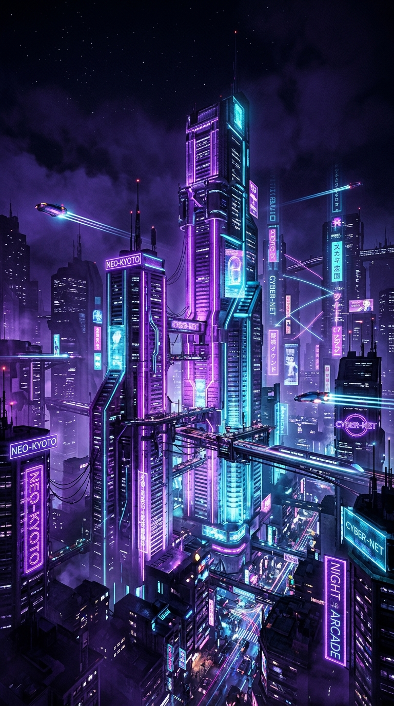

# BEATBOUNCE ⚡

<p align="center">
  
</p>

<p align="center">
  <b>Futuristic 3D Neon Cyberpunk Rhythm Arcade Game for Android</b><br>
  <i>Created by <b>SUBHON & SAYOD</b></i>
</p>

<p align="center">
  
  
  
  
  
</p>

---

## 🎮 Overview

**BEATBOUNCE** is a high-octane 3D rhythm platformer where players guide a glowing cybernetic sphere jumping across floating neon platforms synchronized to electronic dance music. Built natively for Android using Jetpack Compose and custom 3D perspective projection mathematics, the game delivers buttery-smooth 60 FPS performance without requiring third-party game engines or online dependencies.

### ✨ Key Features

- **Cinematic Startup Sequence**: Immersive cyberpunk city intro sequence introducing creators **SUBHON & SAYOD** with glitch-reactive typography and smooth brand reveal (skippable by tapping anywhere).
- **Custom 3D Perspective Projection Engine**: Real-time 3D coordinate transformation `(X, Y, Z) -> Screen(sx, sy)`, dynamic depth scaling, 3D platform extrusion, floating neon rings, and spark particle fountains.
- **Synthesized Music Engine**: Real-time 44.1 kHz stereo EDM music engine with 5 full tracks:
  1. *Neon Velocity* (128 BPM, Cyberpunk EDM)
  2. *Cyber Pulse* (135 BPM, Future Bass)
  3. *Synthwave Sunset* (115 BPM, Retro 80s)
  4. *Electric Horizon* (140 BPM, High Energy EDM)
  5. *Galactic Drift* (120 BPM, Deep Cosmic Trance)
- **Audio-Reactive Visuals**: Skyline skyscrapers, glowing windows, and platform edges pulse with the track's sub-bass energy.
- **4 Distinct Game Modes**:
  - `CLASSIC`: Complete authored music tracks and set personal records.
  - `ENDLESS`: Procedurally generated infinite rhythm run with ramping tempo.
  - `CHALLENGES`: Targeted objectives (100 jumps, combo milestones, accuracy goals).
  - `PERFECT RHYTHM`: Strict ±25ms timing accuracy precision mode.
- **8 Cyber Ball Skins**: *Neon Core*, *Galaxy Orb*, *Fireball*, *Iceball*, *Electric Orb*, *Crystal Ball*, *Cyber Pulse*, and *Golden Energy*.
- **6 Cyberpunk Dimensions**: *Neon Cyber City*, *Galaxy Space*, *Synthwave Sunset*, *Digital Matrix*, *Crystal Universe*, and *Fire & Ice*.
- **Progression & Save System**: Local offline persistence for high scores, coins, unlocked skins/environments, daily quests (`yyyy-MM-dd`), and haptic/audio settings.

---

## 🚀 Releasing to Your GitHub Profile

Follow these steps to publish BEATBOUNCE to your GitHub account:

### 1. Create a New Repository on GitHub
1. Go to [GitHub.com/new](https://github.com/new).
2. Set **Repository name** to `BEATBOUNCE`.
3. Set visibility to **Public**.
4. Leave *"Initialize this repository with a README"* **unchecked** (we already have one).
5. Click **Create repository**.

### 2. Push Code from Your Computer
In your terminal, navigate to this project folder and run:

```bash
git init
git add .
git commit -m "Initial release of BEATBOUNCE by SUBHON & SAYOD"
git branch -M main
git remote add origin https://github.com/<YOUR_GITHUB_USERNAME>/BEATBOUNCE.git
git push -u origin main
```

*(Alternatively, if you are using Google AI Studio Build, click the **Settings / More** menu in the top toolbar and click **Push to GitHub** to link your GitHub account directly!)*

### 3. Create a GitHub Release with Downloadable APK
Releasing a pre-compiled `.apk` lets visitors download and play directly from your GitHub profile!

1. On your GitHub repository page, click **Releases** (on the right sidebar) $\rightarrow$ **Draft a new release**.
2. Click **Choose a tag**: type `v1.0.0` and click *Create new tag*.
3. **Release title**: `BEATBOUNCE v1.0.0 — Official Android Launch`
4. **Description**:
   ```markdown
   ## ⚡ BEATBOUNCE v1.0.0
   Created by **SUBHON & SAYOD**

   Download and install `app-debug.apk` directly onto your Android device!
   - 5 Original EDM & Synthwave tracks
   - 4 Game Modes (Classic, Endless, Challenges, Perfect Rhythm)
   - 8 Ball Skins & 6 Cyberpunk Environments
   - 100% Offline with Local Save System
   ```
5. **Attach APK**: Drag and drop `app/build/outputs/apk/debug/app-debug.apk` into the **Attach binaries** box.
6. Click **Publish release**.

### 4. Pin BEATBOUNCE to Your GitHub Profile
1. Go to your GitHub profile: `https://github.com/<YOUR_USERNAME>`
2. Click **Customize your pins** (or **Edit pins**).
3. Select **BEATBOUNCE** and click **Save pins**.
4. The game will now be featured prominently at the top of your GitHub profile!

---

## 🛠️ Building & Running Locally

### Prerequisites
- **Android Studio** Ladybug (2024.2+) or newer
- **JDK 17+**
- Android SDK 34+ (target SDK 36)

### Running via Android Studio
1. Clone the repository:
   ```bash
   git clone https://github.com/<YOUR_GITHUB_USERNAME>/BEATBOUNCE.git
   ```
2. Open the project folder in Android Studio.
3. Allow Gradle to sync.
4. Select a connected Android device or emulator.
5. Click the green **Run (▶)** button.

### Building via Terminal
- **Assemble Debug APK**:
  ```bash
  gradle :app:assembleDebug
  ```
  Output: `app/build/outputs/apk/debug/app-debug.apk`

- **Assemble Release Bundle (AAB)**:
  ```bash
  gradle :app:bundleRelease
  ```
  Output: `app/build/outputs/bundle/release/app-release.aab`

---

## 📂 Architecture & Project Structure

```
app/src/main/java/com/example/
├── MainActivity.kt               # Lifecycle management, edge-to-edge root
├── audio/
│   ├── SynthesizedMusicEngine.kt # 44.1 kHz PCM synthesizer (5 EDM tracks)
│   └── SoundEffects.kt           # Low-latency SFX synthesizer
├── data/
│   └── SaveManager.kt            # SharedPreferences local persistence
├── game/
│   ├── GameModels.kt             # Skins, environments, platforms, modes
│   ├── ProceduralLevelGenerator.kt # Rhythm platform algorithms
│   └── GameViewModel.kt          # 60 FPS physics loop & state orchestrator
├── rendering/
│   └── GameCanvas3D.kt           # 3D perspective projection Canvas engine
└── ui/
    ├── IntroScreen.kt            # Cinematic creator intro (SUBHON & SAYOD)
    ├── MainMenuScreen.kt         # 3D ball showcase & cyber navigation
    ├── GameplayScreen.kt         # In-game HUD, combo streak, pause dialog
    ├── GameOverScreen.kt         # Animated score count, records, rewards
    ├── MusicSelectScreen.kt      # Track browser & audio previews
    ├── GameModesScreen.kt        # Mode selector cards
    ├── SkinsScreen.kt            # 3D ball customization shop
    ├── EnvironmentsScreen.kt     # Cyberpunk dimension selector
    ├── DailyChallengesScreen.kt  # Quests & achievements
    ├── SettingsScreen.kt         # Audio, sensitivity, haptics, graphics
    └── TutorialDialog.kt         # Interactive visual tutorial
```

---

## 👑 Creators & Credits

- **Game Design & Concept**: SUBHON & SAYOD
- **Architecture & Programming**: SUBHON & SAYOD
- **Sound & Audio Design**: SUBHON & SAYOD

*“LET THE MUSIC CONTROL THE UNIVERSE.”*
